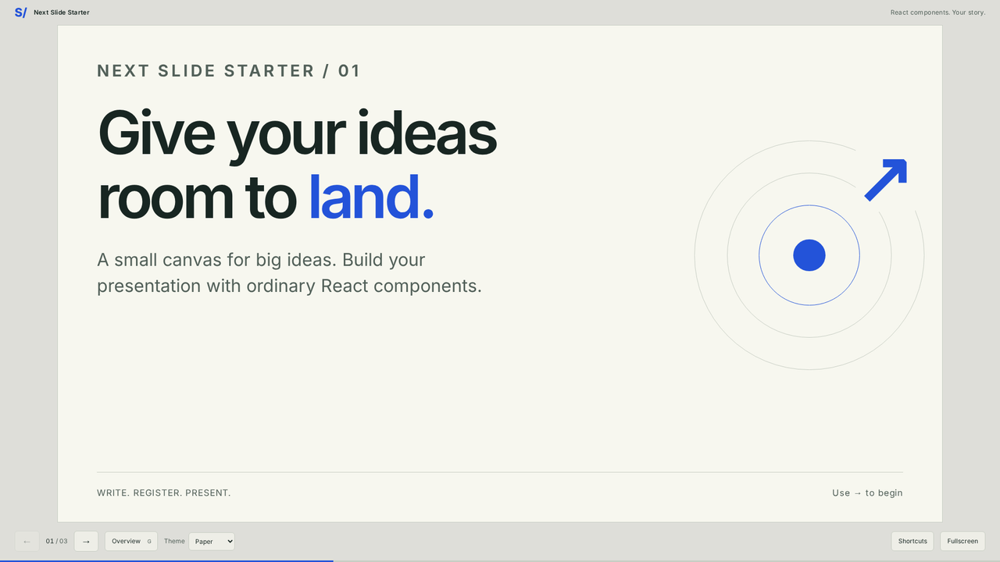

# Next Slide Starter

A small Next.js starter for presentations built from React components. Clone it, write your story, and host the static output wherever you choose. No accounts, database, or runtime services.



## Start

Use **Node.js 24 LTS** and its bundled npm (tested with Node 24.22.0/npm 11.19.1).

```sh
npm ci
npm run dev
```

Open http://localhost:3000. `npm ci` reproduces the committed `package-lock.json`; keep the lockfile when troubleshooting installs.

## Add a slide

1. Create an ordinary component in `src/slides/`:

```tsx
export default function MySlide() {
  return (
    <div className="slide-content">
      <p className="eyebrow">A NEW CHAPTER</p>
      <h1>One clear idea.</h1>
      <p>Your markup, diagrams, images, and interactions.</p>
    </div>
  );
}
```

2. Import it in `src/slides/index.ts` and add `{ id: 'one-clear-idea', title: 'One clear idea', component: MySlide }` to `slides`.
3. Reorder or remove entries to change the deck. Build and present.

IDs must be unique lowercase URL slugs. Titles name slides for assistive technology and the overview. An optional `preview: '/images/my-slide.webp'` supplies a local overview image; otherwise the overview uses a number/title composition. It never mounts every slide to generate previews. Counts come from the array; there is no fixed slide limit. Components sit inside the client presentation boundary, so hooks work without passing component constructors through a server boundary.

Change metadata in `src/app/layout.tsx`, deck labels in `src/deck.config.ts`, and semantic theme tokens in `src/app/globals.css`. Paper, Midnight, Blueprint, and Sand color controls, content, diagrams, and overview together. Theme selection persists locally and keeps slide state.

## Present

- Arrow keys or Page Up/Down: previous/next. Space: next; Shift+Space: previous.
- Home/End: first/last. No wrapping. No scroll-wheel navigation.
- **G** or **Overview**: visual index. Tab between cards, Enter to select, Escape to dismiss.
- **F** or **Fullscreen**: fullscreen where supported. Escape also retains its native fullscreen behavior.
- Share a stable link such as `/#make-it-visible`. Refresh and browser Back/Forward preserve navigation.

Shortcuts pause inside links, buttons, form fields, and editable content, and ignore modified/handled events. Focus stays visible. Changes use a restrained live announcement. Motion respects reduced-motion preferences. Phones use natural scrolling and stacked layouts. Authors still need to check their own compositions, long text, images, zoom, and contrast.

Printing and private presenter notes are intentionally outside this starter. Browser printing does not export the whole deck.

## Optional local languages

Single-language authors need no dictionaries: write JSX and set `language`/`direction` in `deck.config.ts`. Localization ships disabled; `?lang=` is ignored in this mode.

To try the compact English/Urdu example:

1. Import `exampleLocales` from `../examples/localization/locales` in `src/deck.config.ts`.
2. Set `localization` to `{ enabled: true, defaultLocale: 'en', locales: exampleLocales }`.
3. Run and inspect `/?lang=ur#intro`. The example translates shell controls, opener title/content, and sets Urdu RTL. Other slides deliberately retain English.

Local files explicitly register code, label, direction, optional `messages`, `titles` by slide ID, author-defined `content`, and optional `components` overrides by slide ID. Use `useLocale()` from `src/lib/localization.tsx` only in components needing text. There is still **one ordered registry**. Text-only translation can reuse a layout; component overrides support different layouts.

Missing shell labels/titles use the configured default locale then English/original title. Missing components use the original component; custom content should use `??` fallback as in `IntroSlide`. Incomplete definitions warn during development. A language toggle does **not** certify a complete translation: review mixed-language fallback. Invalid locale URLs use the default. URL query, hash, theme, and browser history work together; switching a component can reset its local state. Next/previous still follow canonical order in RTL. Authors supply and review translations and check RTL layout/font coverage; this example is not a claim about future slides. The included local Noto Arabic subset covers the example.

After enabling this example, build, then run `TEST_LOCALIZATION=1 npx playwright test tests/localization.spec.ts` (set the environment variable using your shell's syntax). Restore the configuration for the default single-language starter.

## Project map

```text
src/app/                       page, metadata, theme/style tokens
src/components/presentation/   the presentation shell
src/slides/                    your components and the ordered registry
src/lib/                       navigation and opt-in locale helpers
src/deck.config.ts             deck labels and language configuration
examples/localization/         small opt-in Urdu example
public/fonts/                  local fonts and their licenses
tests/                         focused Chromium browser checks
```

## Checks and contribution

```sh
npm run check                 # ESLint, Prettier, strict TypeScript
npm run build                 # creates out/
npx playwright install chromium
npm run test:e2e              # serves the production export automatically
```

`lint:fix`, `format`, and `format:check` are also available. Husky runs lint-staged on commit, formatting staged files and checking source correctness; it does not build on each commit. See [CONTRIBUTING.md](CONTRIBUTING.md). CI runs checks, build, and Chromium tests with no secrets.

The flat ESLint configuration uses the official Next.js plugin directly plus TypeScript and React hook rules. This avoids ESLint 9-only peer dependencies in `eslint-config-next` while using supported ESLint 10. React Compiler is not enabled. [Official Next.js lint guidance](https://nextjs.org/docs/app/api-reference/config/eslint).

## Build and host

```sh
npm run build
npm run preview
```

Open http://localhost:3000. Restart preview after rebuilding: its production file index is cached. Serve the **contents of `out/`** on any root-domain static host. This is an export-only app; do not use `next start`. It needs no internet after the build is available and the local preview is running. Installation itself needs internet. Opening `file://` is unsupported.

A GitHub Pages repository subpath requires a matching Next.js `basePath` **and** prefixes on public font/image/thumbnail paths (including CSS URLs). The default configuration targets a root domain; subpath deployment has not been validated. [Official static export guide](https://nextjs.org/docs/app/guides/static-exports).

Keep fonts/images local, small, and licensed for redistribution. Give meaningful images useful alt text, reserve dimensions, and use empty alt for decoration. `next/image` is configured unoptimized for export: compress assets before committing. Inter and Noto Sans Arabic are distributed under their included SIL Open Font Licenses; see [font credits](docs/font-credits.md).

## Use as your own

Start from **main** or the `v0.1.0` baseline, replace the three sample components and registry entries, and edit metadata. Event-specific presentations belong on separate branches. The separate [COMSATS event branch](https://github.com/mussaddiqmahmood7/slider/tree/presentation/comsats-sahiwal) is an event example, not the starter source to copy by default.

Original code: [MIT](LICENSE). Third-party fonts and source publications retain their own licenses.
