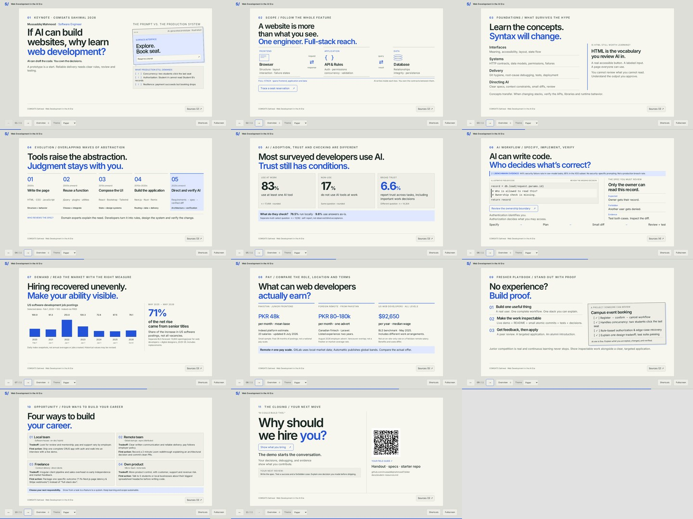

# Web Development in the AI Era

The **COMSATS University Islamabad, Sahiwal Campus** presentation branch. Eleven slides about concepts, broader system ownership, the web’s changing abstractions, working with AI, realistic market evidence and a fresher’s route into paid work.

For the reusable, neutral starter and the three-step authoring guide, use **[main](https://github.com/mussaddiqmahmood7/slider/tree/main)** or **[v0.1.0](https://github.com/mussaddiqmahmood7/slider/tree/v0.1.0)**. Event content is kept off main.



## Run and rehearse

Use **Node 24 LTS** (tested 24.22.0 with npm 11.19.1).

```sh
npm ci
npm run dev
```

For a reliable local presentation:

```sh
npm run build
npm run preview
```

Open http://localhost:3000. Preview serves the static `out/` export; restart it after rebuilding. No `next start`, runtime API, database or external assets are needed. Once dependencies/build output exist, the core deck works without internet while the local server runs. Citation/repository links need internet when opened. `file://` is unsupported.

Use ←/→, Page Up/Down, Space/Shift+Space and Home/End. **G** opens the keyboard-accessible overview. **F** requests fullscreen. Controls remain available for touch; shortcuts pause inside interactive content. Themes persist and keep interaction state. Phones, tablets and short windows use a readable scrolling layout; larger screens retain the 16:9 composition. Deep links include `/#review-the-code` and `/#try-the-work`. Motion respects reduced-motion preferences; phone layouts scroll naturally.

The request trace on slide 2, ownership review on slide 6 and interview-answer reveal on slide 11 are local teaching interactions. Security pseudocode is illustrative, not production security certification. The event is English-only by default. The compact opt-in Urdu example belongs to the neutral starter on main; this talk is not a complete translation.

## Notes, evidence and learning path

- [Student handout: begin here, milestones and primary-resource library](docs/student-resources.md).
- [Speaker notes: 11 slide outlines, timings, prompts and Roman Urdu cues](docs/speaker-notes.md).
- [Research ledger: exact definitions, sources, verification/access status and limits](docs/research.md).
- [Asset credits and licenses](docs/asset-credits.md).
- [Performed validation and remaining limitations](docs/validation.md).

**Research cutoff: 17 October 2026.** Every slide has a consistent COMSATS/talk footer and a **Sources** button with original links and scope notes. Slide 5 distinguishes adoption, trust and checking. Slide 7 shows dated US software-posting index snapshots and a separate seniority analysis, not jobs created. Slide 8 compares a limited Pakistan platform estimate, one remote employer advert and an all-level US benchmark; no universal remote discount or future salary is claimed. Documentation, company perspectives and studies are labeled separately. Some original Pakistan reports remain inaccessible and their export figures are omitted.

The author’s supplied name and Software Engineer role appear on the opener. No employer or personal work history is invented.

## Author and check

Slides are React components in `src/slides/event/`, ordered once in `src/slides/index.ts`. Displayed statistics live in `src/content/evidence.ts`. The same small presentation shell, themes and optional local localization remain underneath.

```sh
npm run check
npm run build
npx playwright install chromium
npm run test:e2e
```

The default suite intentionally skips the starter's opt-in localization test. Its English/Urdu configuration was validated separately on main. CI runs lint, format, types, build and Chromium checks. See [CONTRIBUTING.md](CONTRIBUTING.md). The lockfile is committed for reproducible `npm ci` installs.

Deploy the contents of `out/` to a root-domain static host. Repository-subpath deployment needs a matching Next.js base path and public font/image path prefixes; this configuration has not been validated for subpaths. No whole-deck print/PDF feature or private presenter display is included.

Code/design: [MIT](LICENSE). Fonts and cited data retain their separately documented licenses. The closing QR opens the student handout on this branch; use main when starting your own deck.
